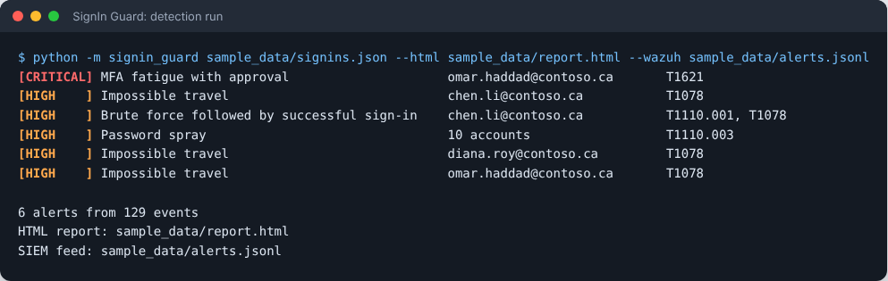
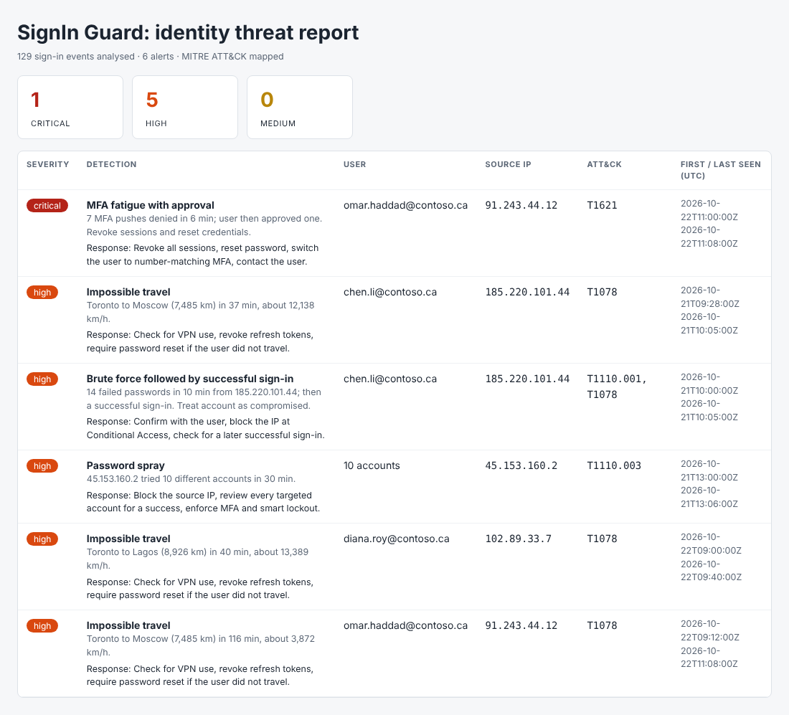
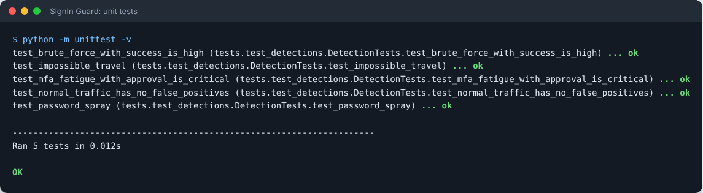

# SignIn Guard

A Python tool that reads Microsoft Entra ID (Azure AD) sign-in logs, detects four common identity attacks, maps each alert to MITRE ATT&CK, and writes an incident report with a recommended response for every alert.



## What it detects

| Detection | MITRE ATT&CK | Rule |
|---|---|---|
| Brute force (+ successful sign-in) | T1110.001, T1078 | 10+ failed passwords for one user from one IP within 10 minutes; high severity if a success follows |
| Password spray | T1110.003 | One IP failing against 5+ different accounts within 30 minutes |
| Impossible travel | T1078 | Two successful sign-ins more than 500 km apart, faster than 900 km/h |
| MFA fatigue (+ approval) | T1621 | 5+ denied MFA pushes within 15 minutes; critical if the user then approves one |

## Example output

These results come from running the tool on the included **synthetic** test data: 3 days of normal sign-ins for 10 test accounts (`@contoso.ca`, not real people) with 4 planted attacks.

**Result: 6 alerts from 129 events.** All 4 planted attacks were found, and no normal user triggered an alert.

### Incident report (`sample_data/report.html`)

Every alert shows its severity, the evidence, the ATT&CK technique, and a response step.



### Unit tests: 5 passed

The tests check each detection and confirm that normal users, including people who occasionally mistype a password, never trigger an alert.



### Output files

| File | What it is |
|---|---|
| [`docs/cli-output.txt`](docs/cli-output.txt) | Terminal output of the detection run |
| [`sample_data/report.html`](sample_data/report.html) | The HTML incident report (download and open in a browser) |
| [`sample_data/alerts.jsonl`](sample_data/alerts.jsonl) | One JSON alert per line, ready for a SIEM to ingest |
| [`docs/test-output.txt`](docs/test-output.txt) | Unit test results |

## Run it yourself

Needs Python 3.9+ and no other packages.

```bash
python -m signin_guard.generate_sample            # create the synthetic test logs
python -m signin_guard sample_data/signins.json --html sample_data/report.html --wazuh sample_data/alerts.jsonl
python -m unittest -v                             # run the 5 tests
```

To analyze real data, export sign-in logs as JSON from the Entra admin center (Monitoring → Sign-in logs → Download) and pass that file instead.

## Microsoft Sentinel

[`sentinel/hunting_queries.kql`](sentinel/hunting_queries.kql) contains the brute-force, password-spray and MFA-fatigue detections as KQL queries for Microsoft Sentinel.

## Project layout

```
signin_guard/detections.py       the four detection rules
signin_guard/report.py           HTML incident report
signin_guard/generate_sample.py  synthetic test logs with planted attacks
signin_guard/__main__.py         command-line tool
tests/test_detections.py         unit tests
sentinel/hunting_queries.kql     the same detections in KQL
docs/                            example output and screenshots
```

## What I learned

Catching an attack was the easy part. Making sure normal people who simply mistype their password don't set off an alarm was much harder, so the tests check exactly that. The tests also caught a bug before release: one trip was raising two impossible-travel alerts (there and back), and I changed the rule to one alert per user.

---
© 2026 Nousheen Fathima. All rights reserved. See [LICENSE](LICENSE).
